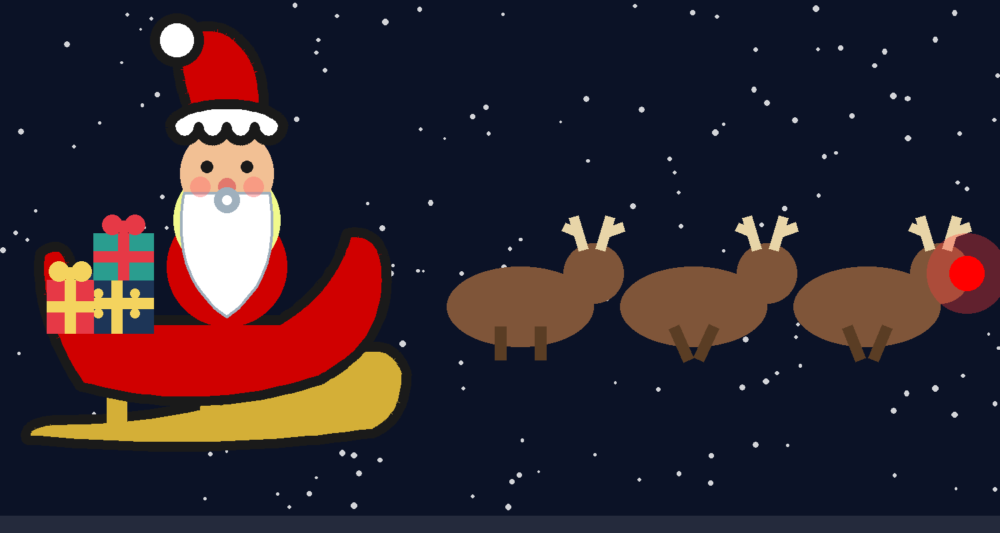
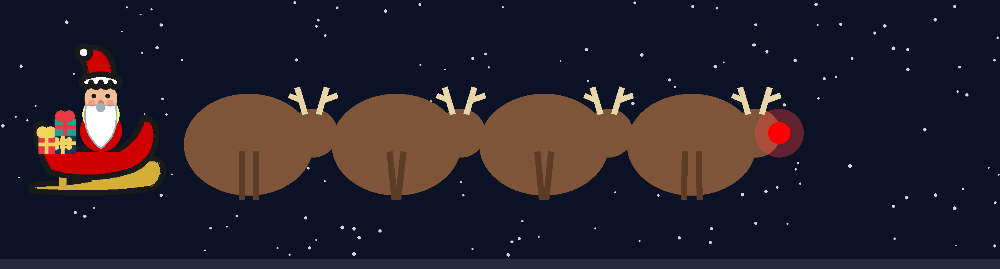

# HermesXSnow ❄️

Snow, Santa, and a very busy reindeer team — a weather-and-Christmas
overlay for the **Hermes Agent desktop app**. Pure canvas, no binary,
works on Linux, Windows, and macOS (X11, Wayland, native).



## ✨ v1.0 — now with legs

v1.0 is the big one: the reindeer team is fully animated. Every
reindeer **trots with swinging legs**, antlers and all, and the herd is
fully configurable — from a solo Rudolph to a 20-deer conga line, or
full **chonker mode** with overweight round reindeer.

<video src="art/legs-demo.mp4" controls muted loop playsinline width="550"></video>

**[▶ leg animation demo](art/legs-demo.mp4)** (up close)

### What's new in v1.0

- 🦌 **Reindeer have legs** — alternating trot gait, synced per reindeer
- 🎚️ **Reindeer slider (1–20)** — 1 is just Rudolph; 20 is a full herd
- 🟤 **Chonker mode** — fat round reindeer, evenly spaced so they never overlap
- 🎛️ **Chonker size slider (1–10)** — shown only in chonker mode (4 is the default chonk)
- 🎨 **Sticker style** — drooping stocking cap, scalloped fluffy brim, fuller beard with eyes / nose / mustache / blush, curved sleigh with gold ski runners
- 🎁 **Fancier presents** — ribbon crosses, bows, and dotted wrapping paper

## Install

### Recommended: the Hermes plugin command (all platforms)

```bash
hermes plugins install https://github.com/shovexxx/xsnow-christmas
```

Works on **Windows, Linux, and macOS** with **no system editing** — no
sudo, no registry changes, no build step, no npm. `hermes plugins install`
clones the repo into your Hermes home (`$HERMES_HOME/plugins/xsnow-christmas/`);
the desktop half (`plugin.js` at the repository root) is then published to
`$HERMES_HOME/desktop-plugins/xsnow-christmas/` by the desktop app's next
plugin scan. Then in the Hermes desktop app:

1. Press <kbd>Ctrl</kbd>/<kbd>⌘</kbd>+<kbd>K</kbd> → **Reload desktop plugins**.
2. Snow starts falling over the chat window. Click **❄️ XSnow** in the
   sidebar to open the control page.

This path was verified end-to-end (CLI install → desktop half detected →
published byte-for-byte identical). Short repo names work too:
`hermes plugins install shovexxx/xsnow-christmas`. To update later:
`hermes plugins update xsnow-christmas` (or re-run install with `--force`).

### Desktop app

In the Hermes desktop app, open **Capabilities → Plugins** →
**Install from Git** and enter:

```bash
https://github.com/shovexxx/xsnow-christmas
```

### One-liner (Unix/macOS)

```bash
curl -fsSL https://raw.githubusercontent.com/shovexxx/xsnow-christmas/main/install.sh | bash
```

### Manual install

```bash
mkdir -p ~/.hermes/desktop-plugins/xsnow-christmas
curl -fsSL https://raw.githubusercontent.com/shovexxx/xsnow-christmas/main/plugin.js \
  -o ~/.hermes/desktop-plugins/xsnow-christmas/plugin.js
```

For a named profile, use `~/.hermes/profiles/<name>/desktop-plugins/` instead.

### Install from a clone

```bash
git clone https://github.com/shovexxx/xsnow-christmas.git
cd xsnow-christmas && ./install.sh
```

## Settings

Open the **❄️ XSnow** page (or the palette command) to tune the scene.
Settings persist per plugin via `ctx.storage`.

| Setting | What it does |
| --- | --- |
| Snowfall | Number of snowflakes (0–400) |
| Speed | Animation speed (×0.25–×2.5) |
| Reindeer | Team size, 1 (just Rudolph) to 20 |
| Chonker mode | Reindeer become fat round chonkers |
| Chonker size | Chonk size 1–10 (only shown in chonker mode, default 4) |
| Santa sleigh | Show Santa + team |
| Trees | Show the trees at the bottom |
| Overlay all windows | Global snow overlay on every chat window |



Tips:
- Toggle the overlay any time from the titlebar ❄️ button, the status-bar
  chip, or the command palette.

## Self-contained, no system changes

The repo is a single plain-JavaScript ESM file (`plugin.js`) plus docs,
`install.sh`, and art. There is no `package.json`, no `node_modules`, no
build step, and no native code. `plugin.js` only imports names the desktop
app itself provides (`@hermes/plugin-sdk` and `react`) and touches browser
APIs (canvas, `document`, `window`). The same file loads identically in the
Electron renderer on Windows, Linux, and macOS — the install is a file copy,
never a system edit.

Optional, on Linux only: the classic X11 `xsnow` binary can be installed
with `sudo dnf install xsnow` (Fedora) / `sudo apt install xsnow`
(Debian/Ubuntu) and run from a terminal for the original watery-window
effect. The in-app canvas version needs none of this.

## Uninstall

```bash
hermes plugins remove xsnow-christmas
```

or, for a manual install, `rm -rf ~/.hermes/desktop-plugins/xsnow-christmas`.
Then reload desktop plugins from the command palette.

## License

MIT — see `LICENSE`.
